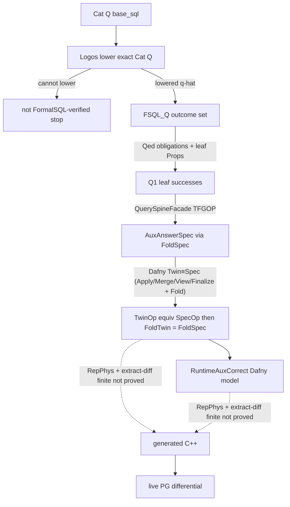

# Verification pipeline: FormalSQL → AuxAnswerSpec → FoldTwin → runtime

This is the correctness story for **generated query accelerators**. Catalog SQL
is lowered by pinned **Logos** into **FormalSQL**. Rocq proves accelerator
`AuxAnswerSpec` membership in FormalSQL outcomes after Embed. Dafny proves
TwinOp ≡ SpecOp and `FoldTwin = FoldSpec`, then maintenance / substrate
`RuntimeAuxCorrect`. Generated C++ is **RepPhys + finite extract-diff**, not a
proved edge.

Implemented migration target: **TPC-H Q1**.

Operational how-to: [`README.md`](README.md). Pin: [`formalsql/PIN.md`](formalsql/PIN.md).

---

## 1. What a green run claims (composed assurance)

```text
Cat(Q)  --Logos lower (fail closed)-->  q̂_Q
FSQL_Q(D) := ℰ_{D,ε}(q̂_Q)

Rocq (Q1 — templatized `delta`, see formalsql/q1/STATUS.md):
  Pre(DB,δ) → Q1NumericSafe DB → FormalSQLNoError_Q(DB,δ)
  Pre(DB,δ) → Q1NumericSafe DB → FormalSQLAuxCorrect_Q(DB,δ)
    := ok(EmbedResult(AuxAnswerSpec(DB, EmbedParams(δ))))
         ∈ outcomes of q̂_Q1(δ) on EmbedDB(DB)
  Catalog fills δ=90; theorems are ∀ DeltaOk δ.

Dafny:
  TwinOp ≡ SpecOp (per operation)
  FoldTwin(DB) = FoldSpec(DB)
  AuxAnswerTwin = AuxAnswerSpec
  Inv_abs(a,DB) ⇔ a = FoldTwin(DB)
  MaintenancePreservesInv ∨ ¬valid
  PairInv / TokenForSnapshot / LocalWriteSafe / SnapshotHitSafe /
  ReadLinearizes / ConsistentObservation / InvalidateBreaksStaleCAS
  RuntimeAuxCorrect:
    AcceleratorHit ⇒ Execute(h) = AuxAnswerTwin(VisibleDB(S,T), θ)

JetStreamFormalSQLCorrect := composed assurance claim
  Rocq FormalSQLAuxCorrect ⊕ Dafny RuntimeAuxCorrect ⊕ AuxSpec hash bridge
  (not a single kernel-checked cross-prover theorem unless the Spec bridge
   is mechanically checked)

C++:
  ∀ x ∈ D_Q. Obs(Twin(x)) = Obs(C++(x))   // extract-diff, finite
  + live PostgreSQL differential backstop
```

---

## 2. Architecture



Proved edges stop at the Dafny/runtime model. C++ is not a proved edge from
`RuntimeAuxCorrect`.

---

## 3. AuxSpec vs twins

```text
Rocq:
  FoldSpec(DB) = iterate AuxSpecOps
  AuxAnswerSpec = FinalizeSpec(ViewSpec(FoldSpec(DB), θ))
  FormalSQLAuxCorrect via EmbedDB / EmbedResult / EmbedParams

Dafny:
  TwinApply ≡ SpecApply, TwinView ≡ SpecView, TwinFinalize ≡ SpecFinalize
  FoldTwin = iterate TwinOps
  FoldTwin = FoldSpec
  AuxAnswerTwin = AuxAnswerSpec
```

Twins remain 1:1 models of generated C++. Fold for Inv/maintenance is
`FoldTwin`. Rocq never names Dafny twin functions.

---

## 4. Runtime obligations (C++ + Dafny substrate)

| Claim | Meaning |
|-------|---------|
| LocalWriteSafe | `PendingRelevantWrites ⇒ ¬AcceleratorHit` (`IsTransactionDirty`) |
| PRE_COMMIT invalidate | Affects ⇒ Invalidate before PG heap visibility |
| TokenForSnapshot | Pin `t` to exact active PG snapshot `S` |
| ReadLinearizes | Check + immutable handles share one linearization |
| ConsistentObservation | Required partitions represent same `DB_t` or fallback |
| InvalidateBreaksStaleCAS | Invalidate bumps version; stale TryPublish fails |

---

## 5. TCB / trust boundary

**Q1 canonical listing:** [`q1/CURRENT_THEOREM_TCB.md`](q1/CURRENT_THEOREM_TCB.md).

### Formal / checked

- FormalSQL Rocq proofs (`FormalSQLAuxCorrect`, `FormalSQLNoError`, NormalizeSound) when green
- Dafny Fold/View/Finalize, Twin≡Spec, Inv, maintenance, Twin↔Aux closed package,
  PairInv, SnapshotHitSafe, ReadHit, LocalWriteSafe model, AffectsNoOp, CAS,
  backend composition

### TCB / assumed / finite

- FormalSQL as authoritative SQL semantics (chosen TCB; publication ≠ proof)
- Rocq kernel / Logos pin SHAs
- Logos lowering (fail closed if unsupported)
- EmbedDB / EmbedResult / EmbedParams value mapping
- **`Q1NumericSafe` packaging:** supported TPC-H domain ⇒ no FormalSQL overflow
  on `q̂_Q1` (canonical §4); value equalities are Qed obligations, not TCB
- **`NumericEmbedFaithful`** (representation hyp)
- PostgreSQL executor for supported fragment
- SPI/heap → abstract DB; snapshot S → DB(S)
- RepPhys; AuxSpec generator (hash-checked dual emission)
- Twin ↔ C++ beyond extract-diff (`cpp_model`)
- Twin SPI: `AggsFaithful`; free Stage/load `RebuildOracleCorrect`
- Unsupported FormalSQL/PG behavior fails closed — never approximated

---

## 6. Removed: hand-written Dafny SQL (MathSem)

Former `Q1Sql.dfy` / `Q1SqlSem.dfy` / MathSem conformance checks are **deleted**.
SQL meaning is **FormalSQL only** (Logos lower of catalog SQL). Do not revive a
Dafny MathSem path as Spec authority.

---

## 7. Runners

```bash
scripts/run_formalsql_smoke.sh
scripts/logos_lower_catalog.sh q1   # fail closed if Logos cannot lower
scripts/run_verification_q1.sh
scripts/run_verification_all.sh
```
